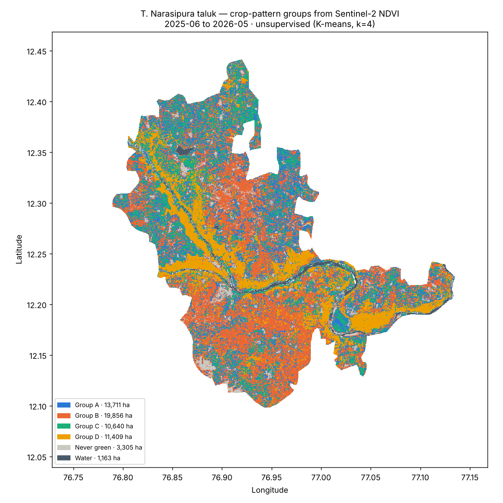
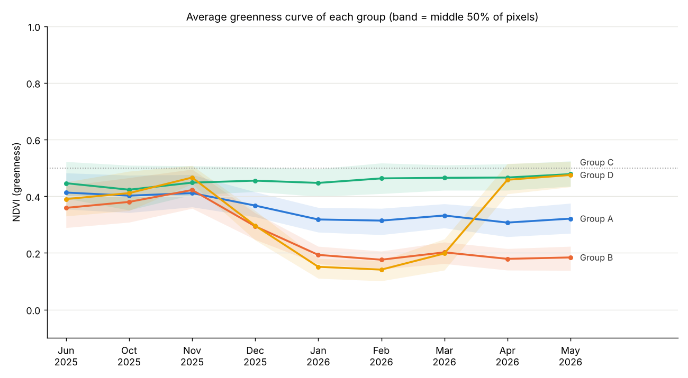

# KrishiDrishti ML

Crop-pattern learning from **Sentinel-2 L2A only** (official Copernicus data, served free by
Microsoft Planetary Computer, no key needed).

## What this model is, and what it isn't

Sentinel-2 shows *how green each field is through the year*. It does **not** say which crop is
growing. So this first model is **unsupervised**: it groups every pixel by the shape of its
yearly greenness (NDVI) curve, using K-means. It outputs groups (A, B, C…) with a plain
description such as "two green seasons", **not crop names**.

To turn groups into crop names, check a few points per group on the ground with
`visit_points.csv`. Those checked fields are the labels for the next, supervised crop model.

## Run it

```bash
cd ml
python -m venv .venv
.venv\Scripts\activate          # Windows  (macOS/Linux: source .venv/bin/activate)
pip install -r requirements.txt

python build_ndvi_stack.py --region "T. Narasipura"   # step 1: download ~1 min
python train_clusters.py --region t-narasipura        # step 2: train ~15 s
```

Other regions: any taluk name (`"Hunsur"`, `"K.R. Nagar"` …) or `"Mysuru"` for the whole district
(about 10× more downloads). Use `--zoom 13` for 19 m pixels instead of 38 m.

## Method

1. **Dates**: every Sentinel-2 L2A acquisition over the region from 1 Jun 2025 to 31 May 2026
   with scene cloud ≤ 60 %; the 4 clearest dates per month are kept.
2. **Cloud masking**: per pixel, using the Sentinel-2 Scene Classification (SCL). Only
   vegetation, bare soil, water and unclassified pixels are kept; cloud, shadow, cirrus and
   saturated pixels are removed.
3. **Monthly NDVI**: median of the clear observations, where NDVI = (B08 − B04) / (B08 + B04).
   Months that are clear in fewer than 50 % of pixels are dropped (July 2025: 14 %).
   **August and September have no usable images**, because monsoon clouds cover them.
4. **Rules**: water (median NDVI < 0) and never-green land (max NDVI < 0.3) are set aside.
5. **K-means** on the 9-month NDVI curve of the remaining pixels; k from 4–8 chosen by
   silhouette score (`--k` to force a value).

## Results: T. Narasipura taluk (Jun 2025 – May 2026, 38 m pixels)




| Group | Area | Greenness pattern (from the data) |
|---|---|---|
| A | 13,711 ha | steady all year, lower (NDVI 0.31–0.41) |
| B | 19,856 ha | one green season, peak Nov, dry Jan–May |
| C | 10,640 ha | steady all year, higher (NDVI 0.42–0.48) |
| D | 11,409 ha | two green seasons (around Nov and Apr–May), dry Jan–Feb; follows the river and canals |
| Never green | 3,305 ha | built-up, rock, bare or permanently fallow |
| Water | 1,163 ha | Kaveri / Kabini rivers, tanks |

Silhouette scores are low (0.16–0.25). Growth patterns blend into each other, and 38 m pixels
often mix several small fields. Treat the groups as a starting map for field checks, not as
final classes.

## Files in `output/<region>/`

| File | |
|---|---|
| `group_map.png`, `group_curves.png` | figures |
| `groups.json` | groups, curves, areas, settings |
| `visit_points.csv` | 12 points per group, with Google Maps links and blank columns to fill in |
| `pattern_model.joblib` | the trained K-means model |
| `stack.npz` | monthly NDVI cube (not committed; rebuild with step 1) |

## Next: the supervised crop model

Fill `crop_observed` in `visit_points.csv`, ideally 30+ fields per crop. Those rows become the
training labels for a supervised classifier (e.g. Random Forest) on the same NDVI curves, with
accuracy measured on fields it has never seen.
